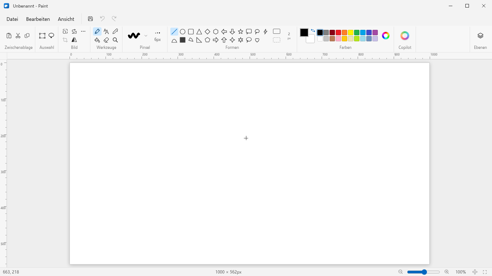

# Paint für Linux

Ein Nachbau von **Microsoft Paint (Windows 11)** für Linux – mit Fluent-Oberfläche, Ribbon, Ebenen, Transparenz, Pinseln, Formen, Text, Auswahlwerkzeugen und Dateiimport/-export.

**GitHub:** [bxnjxmin27/Linux_Paint](https://github.com/bxnjxmin27/Linux_Paint) · **Releases:** [v0.1.0](https://github.com/bxnjxmin27/Linux_Paint/releases/tag/v0.1.0)



> Inspiriert vom Windows-11-Paint. Kein offizielles Microsoft-Produkt, kein Microsoft-Code und keine Microsoft-Dienste.

## Funktionen

- **Oberfläche:** Windows-11-Titelleiste, Datei-/Bearbeiten-/Ansicht-Menüs, Ribbon mit Zwischenablage, Auswahl, Bild, Werkzeugen, Pinseln, Formen, Farben, Copilot-Platzhalter und Ebenen
- **Zeichnen:** Bleistift (1 px, pixelgenau), Radierer (transparent), Füllen, Farbauswahl, Lupe, 9 Pinseltypen
- **Pinsel:** Pinsel, Kalligrafie 1/2, Sprühpinsel, Ölpinsel, Wachsmalstift, Marker, Naturbleistift, Aquarell – inklusive Größen-Flyout und Vorschau
- **Formen:** 23 Formen (Linie, Kurve, Ellipse, Rechtecke, Polygon, Dreiecke, Raute, Fünfeck, Sechseck, Pfeile, Sterne, Sprechblasen, Herz, Blitz) mit Kontur, Füllung, Dicke und Shift-Zwang
- **Auswahl:** Rechteck und Freiform, Verschieben, Skalieren, frei Drehen, Ausschneiden/Kopieren/Einfügen, Zuschneiden, Umkehren, Löschen
- **Text:** Textfeld, Systemschriften, Größe, Fett/Kursiv/Unterstrichen, Ausrichtung, Textfarbe, Hintergrund, Zeilenumbruch
- **Ebenen:** Hinzufügen, Löschen, Duplizieren, Umbenennen, Sichtbarkeit, Reihenfolge (Drag & Drop), Nach unten zusammenführen, Thumbnails, Transparenz
- **Bild:** Größe ändern, Neigen, Canvas-Größe, Drehen, Spiegeln, Farben umkehren, DPI/Eigenschaften
- **Dateien:** Öffnen, Speichern, Speichern unter als **PNG, JPEG, BMP, GIF, TIFF**, Import auf Canvas, Drucken, Zuletzt geöffnet, Drag & Drop, Datei-Assoziationen
- **Ansicht:** 10–800 % Zoom, Fit, 100 %, Vollbild, Lineale, Pixelraster, Statusleiste
- **Deutsch/Englisch** umschaltbar

## 1:1 – was heißt das konkret?

Layout, Proportionen, Farben, Abstände, Icons, Menüs, Dialoge und Tastenkürzel orientieren sich am aktuellen Windows-11-Paint. Für die Schrift wird **Selawik** (SIL OFL, metrisch kompatibel zu Segoe UI) verwendet, für die Icons **Fluent UI System Icons**. Dadurch ist die Optik sehr nah am Original, aber nicht bitidentisch (Schrift-Rendering, Linux-Fensterrahmen, Icon-Details).

Bewusst **nicht** enthalten:

- Microsofts KI-Dienste (Copilot/Cocreator, Image Creator, Hintergrund entfernen) – der Copilot-Button ist ein Platzhalter
- Microsoft-Konto, Cloud, Windows-Snap-Layouts, „Als Desktop-Hintergrund“
- Freies Drehen von bereits gerasterten Formen/Texten (Auswahlen lassen sich frei drehen)
- Exakte Windows-Metadaten (JPEG-EXIF, ICC-Profile, Druckertreiber)

## Entwicklung

Voraussetzungen: Node.js ≥ 22, Linux (getestet auf Fedora 44, Wayland + X11).

```bash
npm install
npm run dev        # Entwicklungsmodus
npm run build      # Produktions-Build (out/)
npm start          # gebauten Build starten
npm run typecheck  # TypeScript prüfen
```

### Pakete bauen

```bash
npm run dist        # AppImage + DEB + RPM
npm run dist:appimage
npm run dist:deb
npm run dist:rpm
```

Ergebnisse liegen in `release/`:

- `Paint-0.1.0.AppImage`
- `paint_0.1.0_amd64.deb`
- `paint-0.1.0.x86_64.rpm`

Auf Fedora 44 benötigt der Debian/RPM-Schritt von electron-builder zusätzlich `libxcrypt-compat` (für das mitgelieferte fpm/Ruby):

```bash
sudo dnf install libxcrypt-compat
```

Die fertigen Pakete gibt es unter **[Releases](https://github.com/bxnjxmin27/Linux_Paint/releases)**.

```bash
# AppImage
chmod +x Paint-0.1.0.AppImage
./Paint-0.1.0.AppImage

# Fedora / openSUSE
sudo dnf install ./paint-0.1.0.x86_64.rpm

# Debian / Ubuntu
sudo apt install ./paint_0.1.0_amd64.deb
```

## Tastenkürzel (Auswahl)

| Kürzel | Aktion |
|---|---|
| `Strg+N` / `Strg+O` / `Strg+S` | Neu / Öffnen / Speichern |
| `Strg+Shift+S` | Speichern unter |
| `Strg+Z` / `Strg+Y` | Rückgängig / Wiederholen |
| `Strg+X` / `Strg+C` / `Strg+V` | Ausschneiden / Kopieren / Einfügen |
| `Strg+A` | Alles auswählen |
| `Entf` | Auswahl löschen |
| `Strg+W` | Größe ändern und neigen |
| `Strg+E` | Eigenschaften |
| `Strg+R` / `Strg+G` | Lineale / Raster |
| `Strg+PageUp` / `Strg+PageDown` | Zoom vergrößern / verkleinern |
| `Strg+0` | 100 % |
| `Strg++` / `Strg+-` | Pinsel-/Formgröße |
| Pfeiltasten | Auswahl um 1 px verschieben (Shift: 10 px) |
| `F11` | Vollbild |
| `Alt+F4` | Beenden (mit Speicherabfrage) |

## Projektstruktur

```
src/main/          Electron-Hauptprozess (Fenster, Dateidialoge, Zwischenablage, Drucken)
src/preload/       typisierte IPC-Brücke
src/renderer/src/
  components/      Titelbar, Menüs, Ribbon, Canvas, Ebenen, Dialoge …
  engine/          Dokument, Ebenen, History, Auswahl, Pinsel, Formen, Dateiformate
  state/           Zustand-Stores (UI, Text, Cursor, Dialoge)
  styles/          Fluent-Tokens und Oberflächen-CSS
  assets/fonts/    Selawik (SIL OFL)
scripts/           Screenshot- und E2E-Testskripte (Playwright)
docs/              Screenshots
```

## Schriften

Die App bündelt **Selawik** unter der SIL Open Font License. Selawik ist eine von Microsoft veröffentlichte, metrisch kompatible Open-Source-Alternative zu Segoe UI. Die Lizenz liegt unter `src/renderer/src/assets/fonts/Selawik-OFL.txt`.

## Lizenz

Quellcode: MIT. Siehe [LICENSE](LICENSE). Third-Party-Komponenten und -Schriften: siehe [THIRD_PARTY_NOTICES.md](THIRD_PARTY_NOTICES.md).
